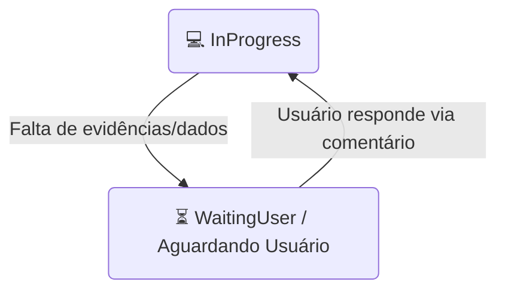
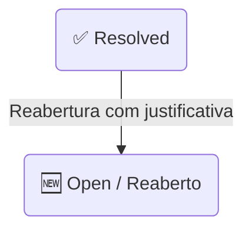

# ABA Desk — Central de Atendimento e Gestão do Ciclo de Vida de Demandas

> **Plataforma Corporativa de Help Desk / Service Desk do Grupo ABA Infra**

---

## 📖 1. Sobre o Projeto

O **ABA Desk** é uma plataforma corporativa desenvolvida para centralizar incidentes, requisições de serviço, solicitações de melhorias e dúvidas operacionais relacionadas aos sistemas de tecnologia utilizados pelas empresas do **Grupo ABA Infra**.

Mais do que um simples "abridor de chamados", o ABA Desk foi concebido como um **orquestrador do ciclo completo de demandas de TI**, garantindo rastreabilidade, previsibilidade e governança técnica desde o primeiro contato do usuário até a resolução efetiva e homologada da solicitação.

---

## 🎯 2. O Problema Resolvido

Em operações com múltiplas unidades e terminais logísticos, solicitações de TI tendem a chegar dispersas por diferentes canais informais (e-mails, mensagens instantâneas e ligações telefônicas). Esse cenário acarreta:

- Perda de histórico de intervenções técnicas.
- Ausência de métricas claras de tempo de atendimento (SLA) e volumetria.
- Falta de clareza sobre o responsável atual pela resolução.
- Dificuldade em priorizar incidentes críticos frente a requisições rotineiras.
- Ausência de validação formal (homologação) antes do encerramento do chamado.

O **ABA Desk** soluciona esses gargalos ao unificar todo o fluxo em uma única esteira digital transparente e auditável.

---

## 🔄 3. Ciclo de Vida do Chamado (Workflow de Estados)

O ciclo de vida de uma solicitação no ABA Desk segue uma máquina de estados finita bem definida:

### 3.1 Fluxo Principal ("Caminho Feliz")

### 3.2 Fluxo com Solicitação de Informações Externas

Quando o atendimento depende de esclarecimentos adicionais do solicitante:

### 3.3 Fluxo de Reabertura

Caso a solução apresentada não tenha resolvido o problema na prática:

---

## 👥 4. Perfis de Acesso e Matriz de Responsabilidade (RBAC)

O sistema implementa **Controle de Acesso Baseado em Papéis** com três perfis principais:

### 1. Usuário Solicitante (`User`)
- Representa os colaboradores das unidades operacionais e departamentos corporativos.
- **Permissões:**
  - Abertura de novos chamados com evidências (imagens/documentos).
  - Visualização restrita aos chamados abertos por ele mesmo.
  - Interação via comentários nos seus chamados.
  - Acesso à consulta com o assistente inteligente **ABA Assist**.
  - Reabertura de chamados resolvidos caso o problema persista.

### 2. Atendente / Suporte Técnico (`Attendant`)
- Representa a equipe técnica de TI, suporte e desenvolvimento.
- **Permissões:**
  - Visualização global de todos os chamados da empresa.
  - Acesso ao quadro **Kanban** de atendimento.
  - Triagem, assunção e atribuição de chamados.
  - Movimentação de status (*Open → InAnalysis → InProgress → WaitingUser → Resolved*).
  - Registro formal da solução técnica adotada.

### 3. Administrador (`Admin`)
- Possui todas as permissões de um Atendente, com privilégios adicionais de gestão:
  - Gerenciamento completo de usuários (cadastro, edição de dados e inativação de contas).
  - Alteração de níveis de privilégio (*User ↔ Attendant ↔ Admin*).
  - Exclusão definitiva de chamados.
  - Acesso a métricas globais e consolidadas de todas as unidades no Dashboard.

---

## 🚦 5. Estados dos Chamados (`TicketStatus`)

| Status | Descrição Operacional | Próximos Estados Permitidos |
| :--- | :--- | :--- |
| **Open (Novo)** | Chamado recém-criado, aguardando triagem técnica da equipe de TI. | `InAnalysis`, `InProgress` |
| **InAnalysis (Em Análise)** | O chamado está sendo avaliado tecnicamente quanto a escopo, impacto e prioridade. | `InProgress`, `WaitingUser`, `Resolved` |
| **InProgress (Em Atendimento)** | A equipe técnica está atuando ativamente na resolução do incidente ou demanda. | `WaitingUser`, `Resolved` |
| **WaitingUser (Aguardando Usuário)** | A demanda necessita de retorno, esclarecimento ou validação do solicitante. | `InProgress`, `Resolved` |
| **Resolved (Resolvido)** | A solução técnica foi aplicada e o chamado foi encerrado com sucesso. | `Open` (mediante reabertura formal com justificativa) |

---

## ✨ 6. Principais Recursos da Plataforma

### 🔐 Autenticação Segura e Stateless
- Baseada em **JSON Web Tokens (JWT)** assinados com algoritmo HMAC-SHA256.
- Hashing criptográfico de senhas utilizando o padrão seguro do ASP.NET Identity (`PBKDF2`).

### 🎫 Gestão de Chamados e Evidências
- Identificação por **número de protocolo sequencial** de fácil memorização.
- Armazenamento binário de imagens de evidência no próprio banco de dados (`byte[]`), garantindo integridade e portabilidade sem acoplamento a discos locais.
- Listagens com paginação eficiente (`page`, `pageSize`) e múltiplos filtros combináveis (status, prioridade, categoria, unidade, sistema, solicitante e responsável).

### 🔔 Notificações em Tempo Real com SignalR
- Hub de WebSockets (`TicketHub`) integrado para atualização instantânea da interface.
- Disparo de notificações automáticas em mudanças de status, novos comentários e solicitações de informação.

### 🤖 Assistente Virtual Inteligente (ABA Assist)
- Chatbot corporativo impulsionado por modelos avançados de IA para suporte operacional.
- Fornece respostas técnicas estruturadas, formatação Markdown com blocos de código copiáveis e persistência de sessões.

### 📊 Dashboard de Indicadores em Tempo Real
- Agregação de métricas no banco de dados (totalizadores por status, prioridade e categoria).
- Visão adaptativa que isola dados pessoais do solicitante e provê visão macro para a liderança técnica.
