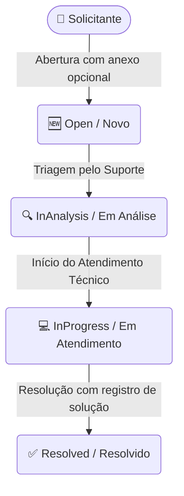
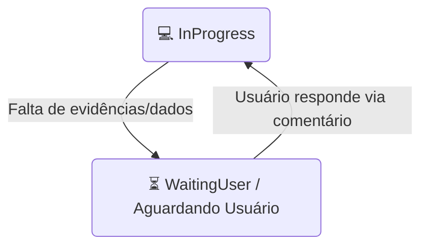
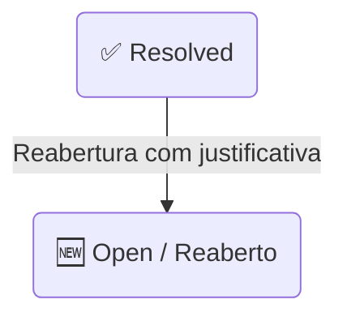

# ABA Desk — Central de Atendimento e Gestão do Ciclo de Vida (Ambiente Dev)

> **Plataforma Corporativa de Gestão de Incidentes e Chamados do Grupo ABA Infra**

---

## 📖 1. Sobre o Projeto

O **ABA Desk** é uma plataforma corporativa desenvolvida para unificar e auditar todo o ciclo de vida das demandas de tecnologia da informação nas empresas do **Grupo ABA Infra**.

O objetivo central é organizar o fluxo de solicitações em uma esteira digital consistente:
`Abertura pelo Colaborador → Triagem e Análise → Atendimento Técnico → Resolução com Solução Documentada → Validação / Homologação`

---

## 🔄 2. Máquina de Estados do Chamado na Branch Dev

### 2.1 Fluxo Operacional Principal

### 2.2 Fluxo de Pendência Externa

### 2.3 Fluxo de Reabertura

---

## 👥 3. Níveis de Acesso e Papéis (RBAC)

1. **Usuário Solicitante (`User`):**
   - Cria novos chamados com anexos opcionais de imagem.
   - Acompanha seus próprios chamados em tempo real.
   - Envia comentários e responde dúvidas da equipe técnica.
   - Reabre chamados resolvidos caso o problema persista.
   - Consulta a assistente inteligente **ABA Assist** para autoatendimento.

2. **Atendente / Suporte Técnico (`Attendant`):**
   - Visualiza todos os chamados da empresa no painel e no quadro Kanban.
   - Assume chamados e inicia a triagem/análise.
   - Transita chamados para atendimento ou solicita informações ao usuário.
   - Finaliza o chamado registrando a solução técnica aplicada.

3. **Administrador (`Admin`):**
   - Privilégios completos de Atendente.
   - Gestão de usuários (cadastro, edição, inativação e troca de perfis).
   - Exclusão de chamados.
   - Acesso a métricas gerenciais e dashboards corporativos.

---

## 🚦 4. Tabela de Status do Chamado (`TicketStatus`)

| Status | Código | Significado | Próximos Passos Válidos |
| :--- | :---: | :--- | :--- |
| **Open** | `0` | Chamado recém-aberto aguardando atendimento. | `InAnalysis`, `InProgress` |
| **InAnalysis** | `1` | Chamado em triagem/avaliação técnica. | `InProgress`, `WaitingUser`, `Resolved` |
| **InProgress** | `2` | Equipe técnica atuando na solução. | `WaitingUser`, `Resolved` |
| **WaitingUser** | `3` | Bloqueado aguardando retorno do solicitante. | `InProgress`, `Resolved` |
| **Resolved** | `4` | Concluído com solução técnica preenchida. | `Open` (mediante reabertura formal) |

---

## ✨ 5. Recursos Habilitados na Branch Dev

- **Notificações em Tempo Real (SignalR):** Atualizações instantâneas de chamados e comentários sem polling.
- **Anexos Binários no Banco:** Imagens salvas como `byte[]` no PostgreSQL com endpoint dedicado de download.
- **Auditoria de Histórico (Audit Trail):** Registro imutável de todas as ações executadas no chamado.
- **ABA Assist (IA):** Endpoint `/api/ai/chat` integrado com agente inteligente para diagnósticos ágeis.
