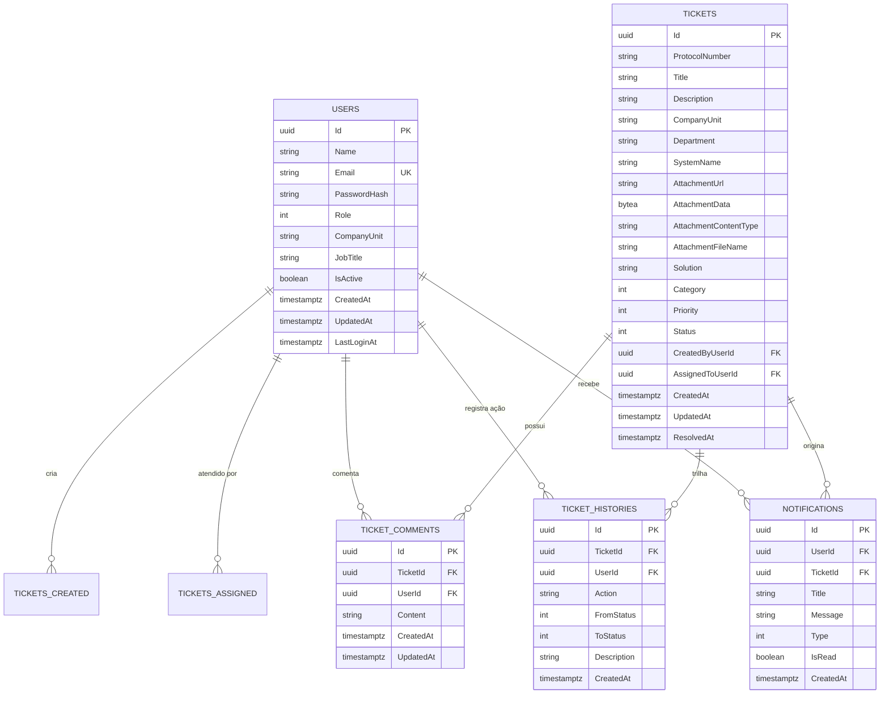

# Esquema do Banco de Dados (Ambiente Dev) — AbaDesk

Este documento detalha o modelo relacional, tabelas, colunas, índices e migrações do banco de dados **PostgreSQL** utilizado no ambiente de desenvolvimento do **AbaDesk**.

---

## 1. Diagrama Entidade-Relacionamento (ERD)



---

## 2. Tabelas Mapeadas no EF Core

Configuradas em [`AppDbContext.cs`](../Data/AppDbContext.cs):

### `Users`
- `Id`: `uuid` (Primary Key).
- `Name`: `text` (Nome do colaborador).
- `Email`: `text` (Índice Único `IX_Users_Email`).
- `PasswordHash`: `text` (Hash PBKDF2).
- `Role`: `integer` (`0: User`, `1: Attendant`, `2: Admin`).
- `CompanyUnit`: `text` (Unidade da empresa).
- `JobTitle`: `text` (Cargo funcional).
- `IsActive`: `boolean` (Permissão de login).
- `CreatedAt`, `UpdatedAt`, `LastLoginAt`: `timestamptz`.

### `Tickets`
- `Id`: `uuid` (Primary Key).
- `ProtocolNumber`: `text` (Índice `IX_Tickets_ProtocolNumber`).
- `Title`, `Description`, `CompanyUnit`, `Department`, `SystemName`: `text`.
- `AttachmentData`: `bytea` (Bytes binários da imagem de evidência).
- `AttachmentContentType`: `text` (MIME type).
- `AttachmentFileName`: `text` (Nome original do arquivo).
- `Solution`: `text` (Solução técnica registrada no encerramento).
- `Category`: `integer` (Bug, Improvement, NewFeature, Question, Access).
- `Priority`: `integer` (Low, Medium, High, Critical).
- `Status`: `integer` (Open, InAnalysis, InProgress, WaitingUser, Resolved).
- `CreatedByUserId`: `uuid` (FK `Users.Id`, `DeleteBehavior.Restrict`).
- `AssignedToUserId`: `uuid` (FK `Users.Id`, `DeleteBehavior.SetNull`).

### `TicketHistories`
- `Id`: `uuid` (Primary Key).
- `TicketId`: `uuid` (FK `Tickets.Id`, `DeleteBehavior.Cascade`).
- `UserId`: `uuid` (FK `Users.Id`, `DeleteBehavior.Restrict`).
- `Action`: `text` (Descrição da ação executada).
- `FromStatus`, `ToStatus`: `integer` (Status anterior e novo).
- `Description`: `text` (Detalhe da mudança).

### `TicketComments`
- `Id`: `uuid` (Primary Key).
- `TicketId`: `uuid` (FK `Tickets.Id`, `DeleteBehavior.Cascade`).
- `UserId`: `uuid` (FK `Users.Id`, `DeleteBehavior.Restrict`).
- `Content`: `text` (Mensagem).

### `Notifications`
- `Id`: `uuid` (Primary Key).
- `UserId`: `uuid` (FK `Users.Id`, `DeleteBehavior.Cascade`).
- `TicketId`: `uuid` (FK `Tickets.Id`, `DeleteBehavior.Cascade`).
- `Title`, `Message`: `text`.
- `Type`: `integer` (StatusChanged, NewComment, etc.).
- `IsRead`: `boolean` (Índice `IX_Notifications_IsRead`).

---

## 3. Comandos Úteis do Entity Framework Core

```bash
# Aplica todas as migrações pendentes no PostgreSQL local
dotnet ef database update

# Gera uma nova migração ao alterar classes da pasta Entities
dotnet ef migrations add NomeDaAlteracao

# Remove a última migração se ainda não aplicada
dotnet ef migrations remove
```

