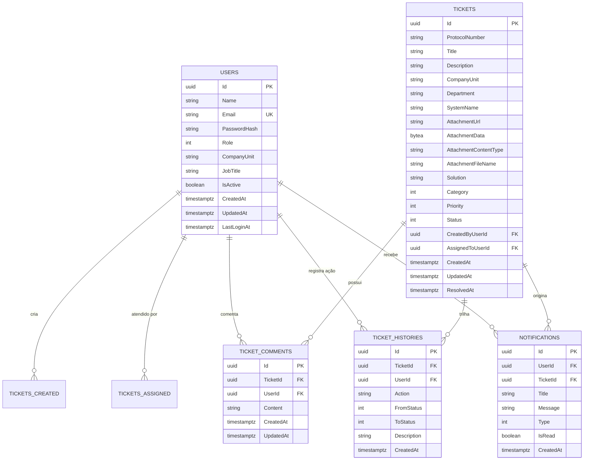

# Esquema do Banco de Dados — AbaDesk

Este documento detalha o modelo relacional de dados, os mapeamentos do **Entity Framework Core**, índices de performance, relacionamentos e migrações implementados no banco **PostgreSQL** do **AbaDesk**.

---

## 1. Diagrama Entidade-Relacionamento (ERD)



---

## 2. Detalhamento das Tabelas e Colunas

### 2.1 Tabela `Users`
Armazena as contas de acesso de colaboradores e gestores:

| Coluna | Tipo no PostgreSQL | Restrições | Descrição |
| :--- | :--- | :--- | :--- |
| `Id` | `uuid` | PK, Not Null | Identificador único global do usuário. |
| `Name` | `text` | Not Null | Nome completo do colaborador. |
| `Email` | `text` | Not Null, Unique | E-mail corporativo utilizado para login. |
| `PasswordHash` | `text` | Not Null | Hash seguro gerado por PBKDF2 com salt. |
| `Role` | `integer` | Not Null | Papel do usuário (`0: User`, `1: Attendant`, `2: Admin`). |
| `CompanyUnit` | `text` | Nullable | Unidade corporativa (ex.: "ABA Infra", "Concais"). |
| `JobTitle` | `text` | Nullable | Cargo ou função exercida pelo colaborador. |
| `IsActive` | `boolean` | Not Null, Default: true | Indica se o usuário pode autenticar no sistema. |
| `CreatedAt` | `timestamptz` | Not Null | Data de criação do cadastro em UTC. |
| `UpdatedAt` | `timestamptz` | Nullable | Data da última alteração de dados em UTC. |
| `LastLoginAt` | `timestamptz` | Nullable | Data e hora do último login com sucesso. |

### 2.2 Tabela `Tickets`
Entidade central do sistema, armazena chamados técnicos e operacionais:

| Coluna | Tipo no PostgreSQL | Restrições | Descrição |
| :--- | :--- | :--- | :--- |
| `Id` | `uuid` | PK, Not Null | Identificador único do chamado. |
| `ProtocolNumber` | `text` | Not Null | Número sequencial de protocolo para referência rápida. |
| `Title` | `text` | Not Null | Título resumido da demanda. |
| `Description` | `text` | Not Null | Descrição detalhada do incidente ou solicitação. |
| `CompanyUnit` | `text` | Not Null | Unidade da empresa onde o incidente ocorreu. |
| `Department` | `text` | Not Null | Departamento solicitante. |
| `SystemName` | `text` | Not Null | Nome do software ou sistema corporativo impactado. |
| `AttachmentData` | `bytea` | Nullable | Conteúdo binário da evidência (imagem anexada). |
| `AttachmentContentType` | `text` | Nullable | MIME Type do arquivo (ex.: `image/png`, `image/jpeg`). |
| `AttachmentFileName` | `text` | Nullable | Nome original do arquivo anexado. |
| `AttachmentUrl` | `text` | Nullable | URL de referência para retrocompatibilidade. |
| `Solution` | `text` | Nullable | Descrição da solução técnica adotada ao resolver. |
| `Category` | `integer` | Not Null | Categoria do chamado (`Bug`, `Improvement`, etc.). |
| `Priority` | `integer` | Not Null | Prioridade (`Low`, `Medium`, `High`, `Critical`). |
| `Status` | `integer` | Not Null | Status atual no workflow (`Open`, `InAnalysis`, etc.). |
| `CreatedByUserId` | `uuid` | FK (`Users.Id`), Restrict | Usuário autor da abertura do chamado. |
| `AssignedToUserId` | `uuid` | FK (`Users.Id`), SetNull | Técnico/Atendente responsável pela resolução. |
| `CreatedAt` | `timestamptz` | Not Null | Data e hora da abertura do chamado (UTC). |
| `UpdatedAt` | `timestamptz` | Nullable | Data da última alteração de estado (UTC). |
| `ResolvedAt` | `timestamptz` | Nullable | Data e hora da resolução definitiva (UTC). |

### 2.3 Tabela `TicketHistories`
Linha do tempo imutável de auditoria (Audit Trail):

| Coluna | Tipo | Restrições | Descrição |
| :--- | :--- | :--- | :--- |
| `Id` | `uuid` | PK | Identificador do registro de auditoria. |
| `TicketId` | `uuid` | FK (`Tickets.Id`), Cascade | Chamado relacionado. |
| `UserId` | `uuid` | FK (`Users.Id`), Restrict | Colaborador que executou a ação. |
| `Action` | `text` | Not Null | Ação realizada (ex.: "Status alterado", "Atribuído"). |
| `FromStatus` | `integer` | Nullable | Status anterior à transição. |
| `ToStatus` | `integer` | Nullable | Novo status após a transição. |
| `Description` | `text` | Not Null | Justificativa ou detalhe textual da mudança. |
| `CreatedAt` | `timestamptz` | Not Null | Data e hora do evento em UTC. |

### 2.4 Tabela `TicketComments`
Thread de comunicação entre solicitantes e equipe técnica:

| Coluna | Tipo | Restrições | Descrição |
| :--- | :--- | :--- | :--- |
| `Id` | `uuid` | PK | Identificador do comentário. |
| `TicketId` | `uuid` | FK (`Tickets.Id`), Cascade | Chamado ao qual a mensagem pertence. |
| `UserId` | `uuid` | FK (`Users.Id`), Restrict | Autor da mensagem. |
| `Content` | `text` | Not Null | Texto do comentário. |
| `CreatedAt` | `timestamptz` | Not Null | Data e hora da postagem (UTC). |
| `UpdatedAt` | `timestamptz` | Nullable | Data da última edição do comentário. |

### 2.5 Tabela `Notifications`
Notificações enviadas aos usuários:

| Coluna | Tipo | Restrições | Descrição |
| :--- | :--- | :--- | :--- |
| `Id` | `uuid` | PK | Identificador da notificação. |
| `UserId` | `uuid` | FK (`Users.Id`), Cascade | Destinatário da notificação. |
| `TicketId` | `uuid` | FK (`Tickets.Id`), Cascade | Chamado relacionado à notificação. |
| `Title` | `text` | Not Null | Título resumido da notificação. |
| `Message` | `text` | Not Null | Conteúdo explicativo da notificação. |
| `Type` | `integer` | Not Null | Tipo da notificação (StatusChanged, NewComment, etc.). |
| `IsRead` | `boolean` | Not Null, Default: false | Indica se a notificação já foi visualizada. |
| `CreatedAt` | `timestamptz` | Not Null | Data de geração do alerta em UTC. |

---

## 3. Índices de Performance

Configurados explicitamente no método `OnModelCreating` de [`AppDbContext.cs`](../Data/AppDbContext.cs):

- `Users`:
  - `IX_Users_Email`: Índice Único (Unique Index) para garantia de unicidade de e-mail e busca ultra rápida no login.
- `Tickets`:
  - `IX_Tickets_Status`: Otimização para os filtros do Kanban e dashboard.
  - `IX_Tickets_Priority`: Aceleração de consultas filtradas por criticidade.
  - `IX_Tickets_CreatedAt`: Otimização de ordenação cronológica das listas.
  - `IX_Tickets_CreatedByUserId`: Agilidade nas consultas de "Meus Chamados".
  - `IX_Tickets_AssignedToUserId`: Busca ágil da fila de trabalho do técnico.
  - `IX_Tickets_ProtocolNumber`: Busca exata por protocolo.
  - `IX_Tickets_SystemName`: Filtros por sistema corporativo.
- `Notifications`:
  - `IX_Notifications_UserId`: Recuperação de alertas por usuário.
  - `IX_Notifications_IsRead`: Filtro de mensagens pendentes de leitura.
  - `IX_Notifications_CreatedAt`: Ordenação de notificações mais recentes.

---

## 4. Enums Mapeados como Inteiros

| Enum | Valores Numéricos e Nomes |
| :--- | :--- |
| **Role** | `0: User`, `1: Attendant`, `2: Admin` |
| **TicketStatus** | `0: Open`, `1: InAnalysis`, `2: InProgress`, `3: WaitingUser`, `4: Resolved` |
| **Priority** | `0: Low`, `1: Medium`, `2: High`, `3: Critical` |
| **Category** | `0: Bug`, `1: Improvement`, `2: NewFeature`, `3: Question`, `4: Access` |
| **NotificationType** | `0: StatusChanged`, `1: NewComment`, `2: InformationRequested`, `3: TicketResolved`, `4: TicketReopened` |

---

## 5. Estratégia de Migrations e Seeding

As migrações do banco são versionadas no diretório [`Migrations/`](../Migrations/) do EF Core:

```bash
# Para aplicar migrações pendentes no banco
dotnet ef database update

# Para criar uma nova migração ao alterar entidades
dotnet ef migrations add NomeDaMigracao
```

Ao inicializar o sistema, o método `SeedAsync` em [`DbSeeder.cs`](../Data/DbSeeder.cs) verifica se a base está vazia e cria os registros padrão com senhas criptografadas, garantindo que o ambiente suba pronto para uso.

